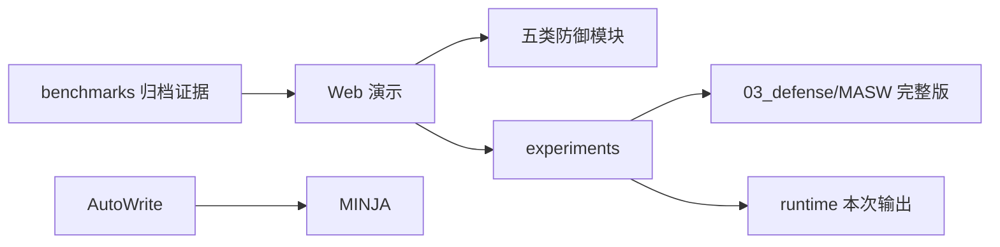

# 架构与模块说明

按作品报告第二章的五种写入路径组织代码，各包的 `pipeline.py` 负责编排，节点文件承载具体逻辑，`config.py` / `types.py` 定义配置与数据结构。

## 五条路径

| 路径 | 入口 | 主要职责 |
| --- | --- | --- |
| 自动写入 | `03_defense/AutoWrite/pipeline.py` | Token 清洗、选择性写入、完整性链、时序衰减、检索对齐、分布监控 |
| 自主写入 | `03_defense/MINJA/pipeline.py` | 写入意图、因果审查、行为仿真、溯源签名、检索审计、执行对齐 |
| 反思写入 | `03_defense/Reflection/pipeline.py` | 反思注入检测、证据锚定、事实一致性、策略审查、写入门控 |
| 开发者写入 | `03_defense/External_Developer_Write/pipeline.py` | 文档上传、分块、检索、检索后验证与后台异常扫描 |
| 共享写入 | `03_defense/MASW/pipeline.py` | 输入标记、候选抽取、风险过滤、写入网关、信任检索、执行仲裁、级联撤销 |

## 报告编号与源码

| 报告节点 | 源码 |
| --- | --- |
| Type 1 D-A–D-F | `03_defense/AutoWrite/da_token_sanitizer.py` 至 `df_distribution_monitor.py` |
| Type 2 D1–D6 | `03_defense/MINJA/d1_query_intent.py` 至 `d6_execution_align.py` |
| Type 3 R1 | `03_defense/Reflection/d1_reflection_intent.py` |
| Type 3 R2 | `03_defense/Reflection/d2_grounding.py` |
| Type 3 R3 | `03_defense/Reflection/d3_consistency.py` |
| Type 3 R4 | `03_defense/Reflection/d4_policy.py` |
| Type 3 R5 | `03_defense/Reflection/d5_write_gate.py` |
| Type 4 E1 上传阶段 | `sp1_embedding_anomaly.py`、`sp2_content_perplexity.py` |
| Type 4 E2 分块阶段 | `sp3_cross_chunk_coherence.py` |
| Type 4 E3 检索聚合 | `sp5_robust_aggregation.py` |
| Type 4 E4 检索后验证 | `sp6_post_retrieval_verifier.py` |
| Type 4 E5 后台巡检 | `sp4_trigger_region.py`、`sp7_semantic_graph.py` |
| Type 5 D1–D7 | `03_defense/MASW/d1_input_label.py` 至 `d7_revocation.py` |

Type 4 表中是职责对应，不表示 SP 组件与报告 E 节点的所有算法细节完全等价。保留已有 D/SP 文件名、公开类名和配置，避免目录整理改变调用行为。

## 公共能力

报告 §2.7 的公共基础能力目前分布在各包中：

- IFC 与信任标签：`03_defense/MINJA/types.py`、`03_defense/Reflection/types.py`、`03_defense/MASW/types.py`；AutoWrite 直接复用 MINJA 类型。
- 密码学完整性：`03_defense/MINJA/d4_provenance.py`、`03_defense/AutoWrite/dc_integrity_chain.py`、`03_defense/Reflection/provenance.py`。
- 审计：各流水线的结构化日志与 `03_defense/MASW/memory_store.py` 的事件存储。
- 向量与模型工具：各模块的 `utils.py`、相似度计算、嵌入和 NLI 接口。

这些能力尚未全部合并为统一公共包。当前整理保留其安全语义和接口边界，不在结构调整中重写信任或签名协议。

## 主线依赖

`06_archive/` 不参与主程序导入。归档简化 MASW 与主线 MASW 同名，只在不同工作目录的独立进程中测试。
